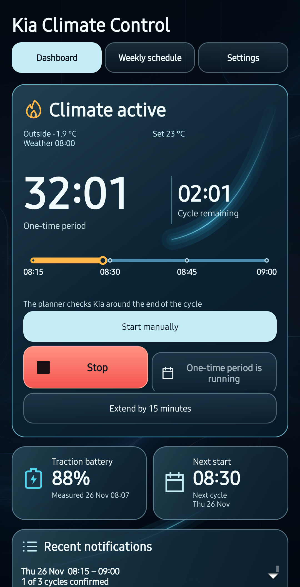
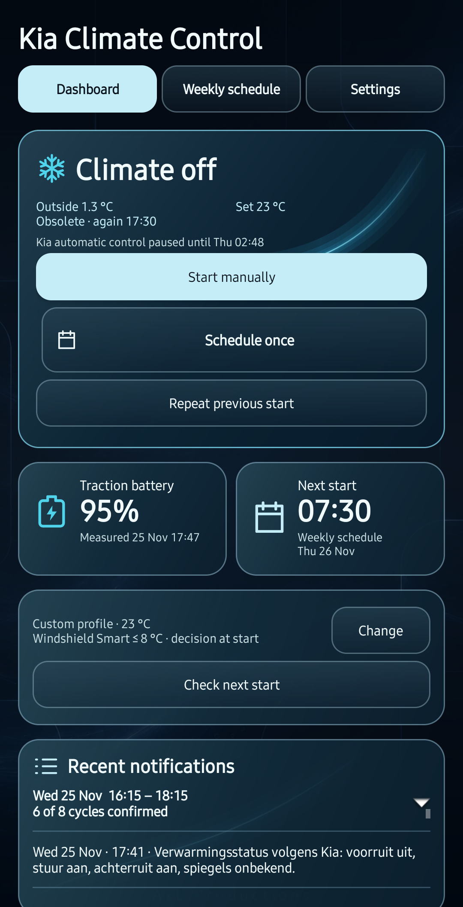
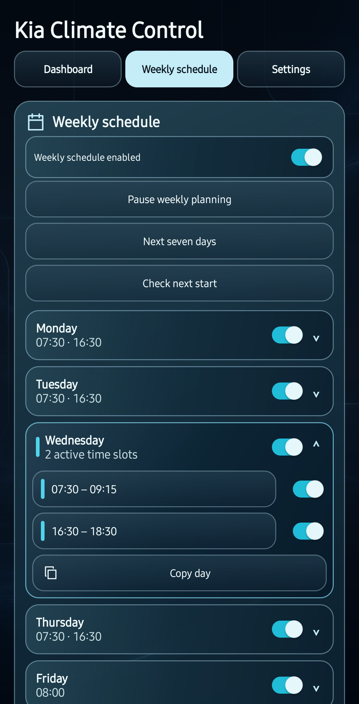
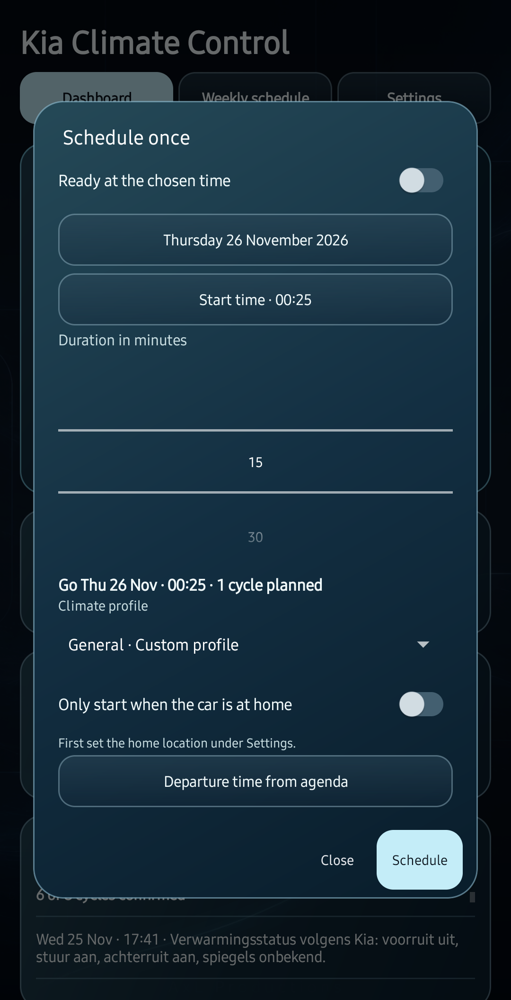
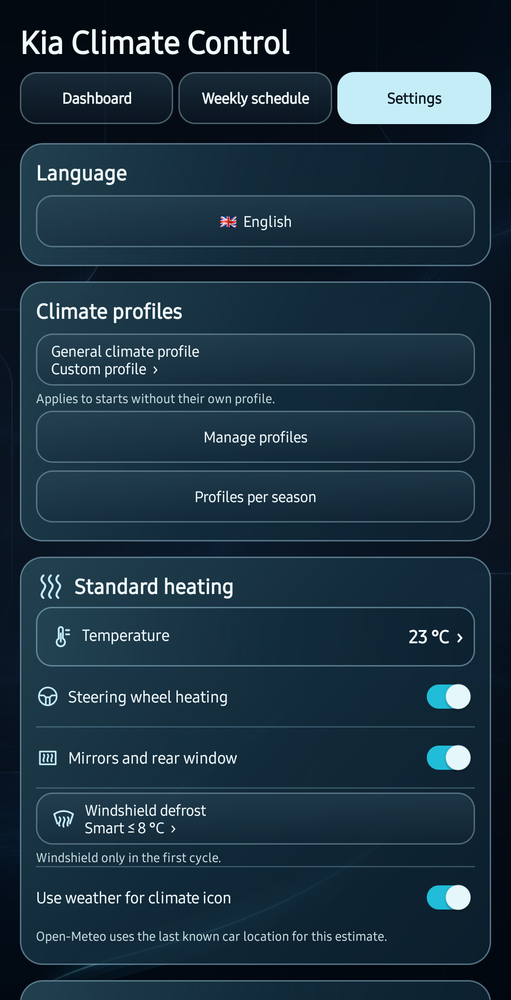

# Kia Climate Control

**[Download the latest Android APK](https://github.com/alexvanleeuwen1979/ev-climate-planner/releases/latest/download/EV-Climate-Planner.apk)** · [Release archive](https://github.com/alexvanleeuwen1979/ev-climate-planner/releases)

[](https://github.com/alexvanleeuwen1979/ev-climate-planner/releases)

The download count includes repeat and test downloads. It may take a little time to update.

Open the downloaded APK on Android 8.0 or later. Each version remains available under its own release tag.

An independent Android app for scheduling remote cabin climate on compatible European Kia vehicles. Live vehicle testing so far has been on a European Kia e-Niro. The app can link other Kia models exposed by the European Kia Connect service and lets you choose a vehicle if your account contains more than one. It controls one selected vehicle at a time. Model, model year, trim, country and Kia Connect capabilities can affect what works. This project is unaffiliated with Kia. Choose Dutch, English, German, French or Spanish in Settings. The app follows a supported phone language initially and otherwise uses English.

## Latest release — 0.5.10

Five minutes before the final confirmed climate cycle ends, a notification offers **+15, +30 or +45 minutes**. Enable notifications for this app in Galaxy Wearable or your watch companion app to receive the actions on a compatible watch. The reminder is enabled by default and can be disabled under **Settings → Notifications → Reminder 5 minutes before the end**.

Timing follows Kia's start confirmation. Extensions update the countdown and the next reminder. Emulator checks passed for all three actions and duplicate-action protection. Delivery and controls on a physical watch still need verification.

[Download 0.5.10 and read the release notes](https://github.com/alexvanleeuwen1979/ev-climate-planner/releases/tag/v0.5.10).

The GitHub APK uses the public release signing certificate. An earlier developer/debug installation may require exporting the planning, uninstalling that build, and signing in again after installing this release. Existing public 0.5.8 and 0.5.9 installations can update with the same release certificate.

## Screenshots

<a href="docs/screenshots/dashboard-active.png"></a>
<a href="docs/screenshots/dashboard-idle.png"></a>
<a href="docs/screenshots/weekly-schedule.png"></a>
<a href="docs/screenshots/schedule-once.png"></a>
<a href="docs/screenshots/settings.png"></a>

## Features

| Area | What you can do |
| --- | --- |
| Manual controls | Start or stop climate, choose a duration in 15-minute steps, override the temperature, repeat the last manual setup, or extend a running window by 15 minutes. Optional device authentication protects manual controls. |
| Planning | Set a one-time start, or edit a weekly schedule with independent day toggles and multiple windows per day. Copy a day, disable or delete a window, pause the weekly schedule, or skip or move an upcoming start with an undo option. Times use a 24-hour clock. |
| Departures | Use a ready-by time, pick a departure time from a calendar event, see the coming seven days, and check schedule and connection readiness. The app can warn if a delayed start pushes the expected finish past departure. Overlapping manual and scheduled time is shown and combined. |
| Climate profiles | Set a default profile and temperature, assign presets or overrides to individual windows and switch profiles by season. Where supported, enable windshield defrost and the European steering wheel, mirror and rear-window heating group. Smart defrost uses a recent outdoor temperature and windshield defrost is disabled after the first cycle. |
| Conditions | Set optional home-location, mild-weather, and unplugged-battery rules for planned starts. Use phone GPS to set a home point. The actual checks use sufficiently recent vehicle information. |
| Cycles | Show a timeline and separate window and cycle countdowns. The cycle timer starts when Kia confirms the start. Follow-up cycles wait for a reported off state. The planner can end a window when it detects that the car was unlocked or is in use, depending on the vehicle status Kia exposes. |
| Dashboard | Show traction-battery percentage, measurement age, target and outdoor temperatures, an estimated heating or cooling indicator, and the next window. Manual refresh and pull-to-refresh are available. Optional hourly battery reads use the latest Kia snapshot. |
| Widget and alerts | Show the upcoming window, profile and active countdown on the home screen. Receive a configurable five-minute final-cycle reminder with +15/+30/+45 minute actions on the phone and compatible paired watches. Configure end-of-window, delayed departure, failed start and rate-limit notifications. Review a scrollable seven-day activity history, with retry and troubleshooting actions. |
| Energy and diagnostics | See daily battery percentage and cumulative estimated climate energy, daily totals by week or month, an individual cycle log, and monthly start outcomes. The energy estimator can learn from suitable measurements. |
| Settings and backups | Switch the interface language using a flag and language name, keep the Kia session encrypted on the device, inspect a planning backup before restoring it, run a connection diagnostic, and export a limited diagnostic log without credentials, VIN or exact location. |

## Known limitations

- The app uses an unofficial integration. It depends on Kia Connect, internet access and Android alarm permissions for background scheduling with the phone locked.
- On the tested e-Niro a climate cycle lasted about 15 minutes. Continuation can be delayed by vehicle confirmation or an older status snapshot. A confirmed manual stop normally allows a new manual start, subject to Kia accepting it.
- Polling every two minutes caused too many requests in testing. The app now checks around the expected end of a cycle, with a follow-up if needed. Kia has returned an actual request-limit error for status reads and a manual climate attempt. Its exact quota and reset window are unverified. A manual start or stop can still be attempted during the local pause. Successful manual status recovery clears the pause.
- Steering wheel, mirrors and rear-window heating worked as a group on the tested e-Niro. Driver-seat heating did not work in the tests and is not offered. Heating, defrost, lock status and location capability vary by model.
- Heat versus cool is estimated when the vehicle does not report the mode. Energy is also an estimate rather than a direct meter reading. The percentage equivalent shown in the cycle log uses the 64 kWh e-Niro as its reference. Charging and driving can affect battery readings and exclude samples from calibration.
- An exact phone location can set the home point. It does not supply the car's position. A location-based schedule still needs usable Kia vehicle location data.
- Activity messages already recorded retain the language used when they were written. The language selection affects the interface and new app-generated messages.
- Only the European Kia Connect route is configured. Verified results for other models are welcome. Please include only the model, model year, region and which functions worked. Keep credentials, VIN, location and raw logs out of public issues.

## Build from source

The current build is set up for Windows. Install JDK 21, Python 3.15, Android SDK 36 and Android NDK `28.2.13676358`. Set `ANDROID_HOME` to the SDK directory and make sure `python` is on your path. The app runs on Android 8.0 or later.

```powershell
.\gradlew.bat :app:testDebugUnitTest :app:assembleDebug
```

The debug APK is written to `app/build/outputs/apk/debug/`. The project includes [artwork and backgrounds](app/src/main/res/drawable-nodpi), [icons and drawables](app/src/main/res/drawable), [launcher resources](app/src/main/res/mipmap-anydpi-v26), and [layouts](app/src/main/res/layout). These are the same resources used by the build. Kia marks and logos belong to their respective rights holders.

## Credits

Thanks to **Fuat Akgun** and the **Hyundai-Kia-Connect contributors** for the MIT-licensed [hyundai_kia_connect_api Python wrapper](https://github.com/Hyundai-Kia-Connect/hyundai_kia_connect_api). This Android app uses their library to communicate with Kia Connect.

## Publish an Android release

Build and sign the release APK with the same private signing key used for previous releases. Update the version in `app/build.gradle` and push its source commit before publishing. Authenticate the GitHub CLI and run the publisher with your signed APK and release notes.

```powershell
.\scripts\Publish-AndroidRelease.ps1 -Version 0.5.9 -ApkPath .\path\to\signed.apk -NotesPath .\path\to\release-notes.md
```

The publisher uploads `EV-Climate-Planner.apk` to a new version tag and marks that release as latest. The download at the top of this page then serves the new APK. Past releases retain their own downloadable APKs and notes. The publisher does not contain or upload a signing key.
